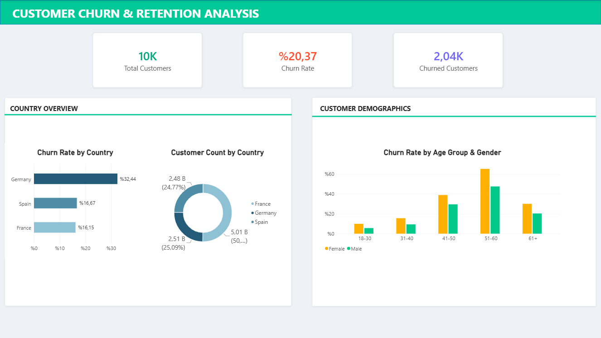
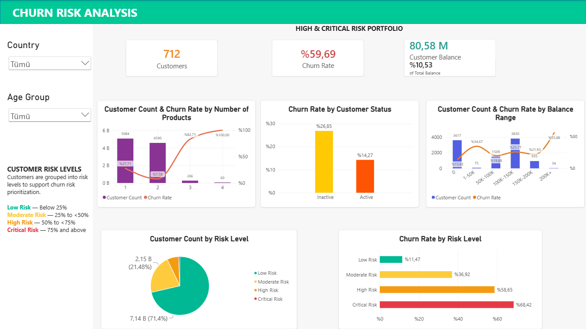
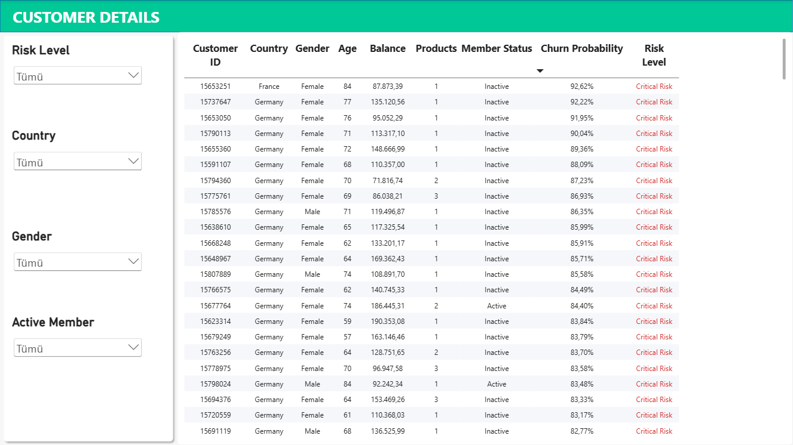

# Bank Customer Churn Analysis: Python + Power BI

🇹🇷 [Türkçe versiyon](README_TR.md)

I analyzed churn behavior across 10,000 bank customers, identified the highest-risk customer segments, built a Logistic Regression model to estimate each customer's churn probability, and presented the results in a 3-page Power BI dashboard.

**Tools:** Python (pandas, NumPy, matplotlib, seaborn, scikit-learn) · VS Code · Power BI

---

## 1. Business Problem

Retaining an existing bank customer is usually cheaper than acquiring a new one. This project aims to answer:

- Which customers are leaving the bank?
- Which segments have the highest churn rates?
- Which customers should be prioritized for retention actions?

## 2. Dataset

- **Source:** Kaggle, *Bank Customer Churn Prediction*
- **Size:** 10,000 customers, 12 columns
- **Data quality:** No missing values and no duplicate customer records
- **Target variable:** `churn` (0 = stayed, 1 = left). Overall churn rate: **20.4%**
- **Features:** credit score, country, gender, age, tenure, balance, number of products, credit card, active membership, estimated salary

## 3. Methodology

1. **Data checks:** Data types, missing values, duplicates, zero-balance customers
2. **Segmentation:** Age groups (18-30, 31-40, 41-50, 51-60, 61+) and balance ranges (0, 1-50K, 50K-100K, 100K-150K, 150K-200K, 200K+)
3. **Segment-level churn analysis:** Country, age, balance, activity status, number of products. Customer count and churn rate were examined together for each segment
4. **Rule-based risk score:** Counting three risk factors: inactive membership, age 41-60, and holding a single product
5. **Predictive model:** Logistic Regression to estimate churn probability for each customer
6. **Dashboard:** Results visualized in Power BI

## 4. Key Findings

| Segment | Churn rate |
|---|---|
| Inactive members | 26.9% (14.3% for active members) |
| Age 51-60 | 56.2% (7.5% for ages 18-30) |
| Germany | 32.4% (France 16.2%, Spain 16.7%) |
| Customers with 1 product | 27.7% |
| Customers with 2 products | 7.6% (lowest) |
| Customers with 3 products | 82.7% |
| Female / Male | 25.1% / 16.5% |

**The rule-based risk score separates segments well:**

| Number of risk factors | Segment | Customers | Churn rate |
|---|---|---|---|
| 0 | Low Risk | 1,847 | 5.2% |
| 1 | Moderate Risk | 4,189 | 12.4% |
| 2 | High Risk | 3,031 | 27.6% |
| 3 | Critical Risk | 933 | 62.6% |

**Points to keep in mind:**
- Customers with 4 products (100% churn) number only 60, and the 200K+ balance group (55.9%) only 34. These rates should be interpreted cautiously because of the small sample sizes.
- Zero-balance customers (3,617) have a relatively low churn rate of 13.8%, while the 100K-150K balance group has a 25.8% churn rate and the most lost customers (987).

## 5. Predictive Model: Logistic Regression

- **Features:** `credit_score`, `country`, `gender`, `age`, `tenure`, `balance`, `products_number`, `credit_card`, `active_member`, `estimated_salary` (`customer_id` was not used)
- **Preprocessing:** `StandardScaler` for numeric variables, `OneHotEncoder(drop="first", handle_unknown="ignore")` for categorical variables
- **Data split:** 80% train / 20% test, `random_state=42`, `stratify=y`
- **Model:** `LogisticRegression(max_iter=1000, random_state=42)`

### Test set performance (2,000 customers, decision threshold 0.50)

| Metric | Result |
|---|---|
| ROC-AUC | 0.775 |
| Accuracy | 0.808 |
| Precision (Churn = 1) | 0.589 |
| Recall (Churn = 1) | 0.187 |
| F1-score (Churn = 1) | 0.284 |

| | Predicted: 0 | Predicted: 1 |
|---|---|---|
| **Actual: 0** | 1540 | 53 |
| **Actual: 1** | 331 | 76 |

**Interpretation:** The model ranks customers by risk reasonably well (ROC-AUC 0.775). However, at the 0.50 threshold it catches only 18.7% of customers who actually left (331 missed churners). Because the data is imbalanced (20% churn), accuracy (80.8%) is misleading: a model that flags nobody as churn would still reach about 80% accuracy. The model is therefore better suited for **prioritizing customers by risk** than for predicting who will definitely leave.

### `churn_probability` in the dashboard

The risk scores in the dashboard were generated for **all 10,000 customers** using the trained model's `predict_proba(X)[:, 1]` and added to `customer_churn_powerbi.csv`. Since about 80% of customers were part of the model's training data, these scores are also computed on training data. The model's true performance is reported above on the held-out test set only.

Model probabilities were grouped into four levels:

| Level | Probability range | Customers | Actual churn rate |
|---|---|---|---|
| Low Risk | 0-25% | 7,140 | 11.5% |
| Moderate Risk | 25-50% | 2,148 | 36.9% |
| High Risk | 50-75% | 636 | 58.6% |
| Critical Risk | 75%+ | 76 | 68.4% |

## 6. Power BI Dashboard

The dashboard has three pages.

### Executive Overview
High-level view: total customers (10K), overall churn rate (20.37%), and churned customers (2.04K), plus churn rate and customer distribution by country and churn rate by age group and gender.



### Risk Analysis
A page focused on the high and critical risk portfolio: the 712 customers in this group have a 59.69% churn rate and hold 10.53% of total balance (80.58 M). It shows churn by number of products, activity status, and balance range, along with the distribution of model risk levels. Country and age group filters are available.



### Customer Details
A customer-level table with country, gender, age, balance, number of products, member status, churn probability, and risk level. Filters for risk level, country, gender, and activity status make it possible to build an action list of customers to contact.



## 7. Business Recommendations

1. **Target inactive customers:** Churn among inactive members is nearly double. Activation campaigns (mobile app usage, card spending incentives) should come first.
2. **Retention program for ages 40-60:** Churn is 34% for ages 41-50 and 56% for ages 51-60.
3. **Investigate Germany separately:** Germany's churn rate is about twice that of the other countries. Product, pricing, or competition could be behind it; the data does not explain why, so field research is needed.
4. **Manage product cross-selling carefully:** Offering a second product to single-product customers looks sensible (2-product customers churn at 7.6%), but churn is very high among customers with 3-4 products. This data cannot explain why.
5. **Prioritize critical-risk customers:** Of the 933 customers carrying all three risk factors, 62.6% left. With a limited budget, this group is the first place to focus.

## 8. Limitations

- **Correlation is not causation.** The findings show who leaves, not why.
- **Static snapshot.** With no time dimension, churn over time could not be analyzed.
- **Low model recall (0.187).** The default 0.50 threshold misses most churners.
- **Small groups:** The 3-4 product and 200K+ balance groups have small samples.
- **Kaggle dataset.** It is unclear whether the data comes from a real bank; results apply to this dataset.

## 9. Next Steps

- Lower the decision threshold (e.g., 0.30) and examine the precision-recall trade-off
- Retrain with `class_weight="balanced"`
- Compare other models such as Random Forest and Gradient Boosting
- Interpret coefficients to show which features drive churn the most
- Repeat the analysis in SQL

## 10. Repository Structure

```
bank-churn-analysis/
├── README.md                                # English
├── README_TR.md                             # Türkçe
├── data/
│   ├── Bank_Customer_Churn_Prediction.csv   # raw data (Kaggle)
│   ├── customer_churn_cleaned.csv
│   └── customer_churn_powerbi.csv           # data prepared for Power BI
├── notebooks/
│   └── churn_analysis.ipynb
├── outputs/                                 # segment analysis outputs (CSV)
├── dashboard/
│   └── Customer_Churn_Analysis_Final.pbix
└── images/                                  # dashboard screenshots
```

## 11. How to Run

```bash
pip install pandas numpy matplotlib seaborn scikit-learn jupyter
jupyter notebook notebooks/churn_analysis.ipynb
```

To open the dashboard, open `dashboard/Customer_Churn_Analysis_Final.pbix` with Power BI Desktop.

---

**Data source:** Kaggle, Bank Customer Churn Prediction
