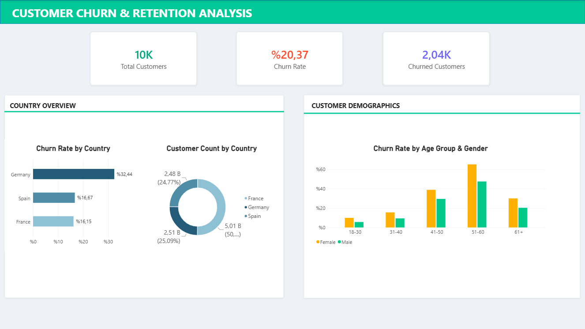
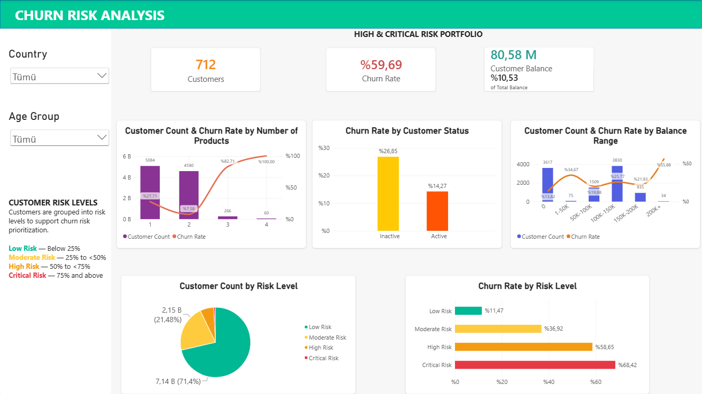
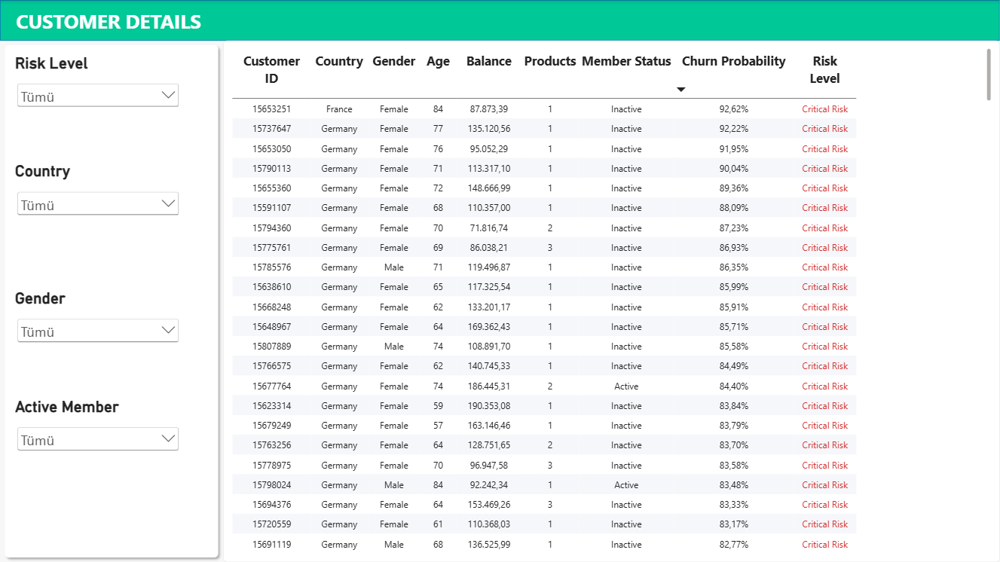

# Banka Müşteri Kaybı (Churn) Analizi: Python + Power BI

🇬🇧 [English version](README.md)

10.000 banka müşterisinde churn (ayrılma) davranışını analiz ettim, en riskli müşteri segmentlerini belirledim, bir Logistic Regression modeliyle her müşteri için churn olasılığı ürettim ve sonuçları 3 sayfalık bir Power BI dashboard'unda sundum.

**Araçlar:** Python (pandas, NumPy, matplotlib, seaborn, scikit-learn) · VS Code · Power BI

---

## 1. İş Problemi

Bir bankada mevcut müşteriyi elde tutmak, yeni müşteri kazanmaktan genellikle daha ucuzdur. Bu projede şu sorulara cevap aradım:

- Hangi müşteriler banka ile ilişkisini sonlandırıyor?
- Hangi segmentlerde churn oranı yüksek?
- Hangi müşterilere öncelikli elde tutma aksiyonu uygulanmalı?

## 2. Veri Seti

- **Kaynak:** Kaggle, *Bank Customer Churn Prediction*
- **Boyut:** 10.000 müşteri, 12 sütun
- **Veri kalitesi:** Eksik değer ve tekrar eden müşteri kaydı yok
- **Hedef değişken:** `churn` (0 = kaldı, 1 = ayrıldı). Genel churn oranı **%20,4**
- **Özellikler:** kredi skoru, ülke, cinsiyet, yaş, müşteri süresi (tenure), bakiye, ürün sayısı, kredi kartı, aktif üyelik, tahmini maaş

## 3. Yöntem

1. **Veri kontrolü:** Veri tipleri, eksik değerler, tekrar eden kayıtlar, sıfır bakiyeli müşteriler
2. **Segmentasyon:** Yaş grupları (18-30, 31-40, 41-50, 51-60, 61+) ve bakiye aralıkları (0, 1-50K, 50K-100K, 100K-150K, 150K-200K, 200K+)
3. **Segment bazlı churn analizi:** Ülke, yaş, bakiye, aktiflik, ürün sayısı. Her segmentte müşteri sayısı ve churn oranı birlikte incelendi
4. **Kural tabanlı risk skoru:** Üç risk faktörü sayıldı: aktif olmama, 41-60 yaş aralığı, tek ürüne sahip olma
5. **Tahmin modeli:** Logistic Regression ile her müşteri için churn olasılığı
6. **Dashboard:** Sonuçlar Power BI'da görselleştirildi

## 4. Temel Bulgular

| Segment | Churn oranı |
|---|---|
| Aktif olmayan üyeler | %26,9 (aktif üyelerde %14,3) |
| 51-60 yaş grubu | %56,2 (18-30 yaşta %7,5) |
| Almanya | %32,4 (Fransa %16,2, İspanya %16,7) |
| Tek ürünlü müşteriler | %27,7 |
| 2 ürünlü müşteriler | %7,6 (en düşük) |
| 3 ürünlü müşteriler | %82,7 |
| Kadın / Erkek | %25,1 / %16,5 |

**Kural tabanlı risk skoru segmentleri iyi ayırıyor:**

| Risk faktörü sayısı | Segment | Müşteri | Churn oranı |
|---|---|---|---|
| 0 | Low Risk | 1.847 | %5,2 |
| 1 | Moderate Risk | 4.189 | %12,4 |
| 2 | High Risk | 3.031 | %27,6 |
| 3 | Critical Risk | 933 | %62,6 |

**Dikkat edilmesi gerekenler:**
- 4 ürünlü müşteriler (%100 churn) yalnızca 60 kişi, 200K+ bakiye grubu (%55,9) yalnızca 34 kişi. Bu oranlar küçük örneklem nedeniyle temkinli yorumlanmalı.
- Sıfır bakiyeli müşteriler (3.617 kişi) %13,8 churn ile göreceli düşük kalırken, 100K-150K bakiye grubu %25,8 churn ve 987 ayrılan müşteriyle en çok kayıp veren grup.

## 5. Tahmin Modeli: Logistic Regression

- **Özellikler:** `credit_score`, `country`, `gender`, `age`, `tenure`, `balance`, `products_number`, `credit_card`, `active_member`, `estimated_salary` (`customer_id` kullanılmadı)
- **Ön işleme:** Sayısal değişkenlerde `StandardScaler`, kategorik değişkenlerde `OneHotEncoder(drop="first", handle_unknown="ignore")`
- **Veri bölme:** %80 eğitim / %20 test, `random_state=42`, `stratify=y`
- **Model:** `LogisticRegression(max_iter=1000, random_state=42)`

### Test seti performansı (2.000 müşteri, karar eşiği 0,50)

| Metrik | Sonuç |
|---|---|
| ROC-AUC | 0,775 |
| Accuracy | 0,808 |
| Precision (Churn = 1) | 0,589 |
| Recall (Churn = 1) | 0,187 |
| F1-score (Churn = 1) | 0,284 |

| | Tahmin: 0 | Tahmin: 1 |
|---|---|---|
| **Gerçek: 0** | 1540 | 53 |
| **Gerçek: 1** | 331 | 76 |

**Yorum:** Model, müşterileri risklerine göre sıralamada makul bir performans gösteriyor (ROC-AUC 0,775). Ancak 0,50 eşiğinde ayrılan müşterilerin yalnızca %18,7'sini yakalıyor (331 kaçırılmış churn). Veri dengesiz (%20 churn) olduğu için accuracy (%80,8) yanıltıcıdır: hiçbir müşteriyi churn olarak işaretlemeyen bir model bile yaklaşık %80 accuracy alırdı. Bu nedenle model, "kesin ayrılacak" tahmini yapmaktan çok, **riske göre öncelik sıralaması** için kullanılmalıdır.

### Eşik analizi

Varsayılan 0,50 eşiği tek seçenek değil. Test setinde farklı eşikler denendiğinde precision-recall dengesi şöyle değişiyor:

| Eşik | Precision | Recall | F1-score |
|---|---|---|---|
| 0,20 | %37,6 | %72,0 | %49,4 |
| 0,25 | %43,1 | %60,2 | %50,2 |
| 0,30 | %48,5 | %51,6 | %50,0 |
| 0,35 | %51,5 | %41,5 | %46,0 |
| 0,40 | %53,1 | %31,2 | %39,3 |
| 0,45 | %54,0 | %24,8 | %34,0 |
| 0,50 | %58,9 | %18,7 | %28,4 |

Eşiği 0,50'den 0,30'a düşürmek recall'u %18,7'den %51,6'ya çıkarıyor (model ayrılanların beşte birini değil yaklaşık yarısını yakalıyor), precision ise %58,9'dan %48,5'e düşüyor. Doğru eşik, bir elde tutma teklifinin maliyeti ile müşteri kaybının maliyetinin karşılaştırılmasına bağlıdır.

### Churn'ü ne belirliyor?

Logistic Regression katsayıları (sayısal değişkenler standartlaştırıldığı için büyüklükler karşılaştırılabilir; pozitif değer churn olasılığını artırır):

| Özellik | Katsayı | Yorum |
|---|---|---|
| Ülke: Almanya | +0,82 | Fransa'ya göre daha yüksek churn |
| Yaş | +0,74 | Yaşlı müşteriler daha çok ayrılıyor |
| Cinsiyet: Erkek | -0,52 | Kadın müşteriler daha çok ayrılıyor |
| Aktif üye | -0,52 | Aktif üyeler daha az ayrılıyor |
| Bakiye | +0,16 | Bakiye arttıkça churn hafifçe artıyor |

Bunlar bu veri setindeki ilişkilerdir, neden-sonuç kanıtı değildir.

### Dashboard'daki `churn_probability`

Dashboard'daki risk skorları, eğitilen modelle `predict_proba(X)[:, 1]` kullanılarak **tüm 10.000 müşteri** için üretildi ve `customer_churn_powerbi.csv` dosyasına eklendi. Müşterilerin yaklaşık %80'i modelin eğitim verisinde yer aldığından bu skorlar eğitim verisi üzerinde de hesaplanmıştır. Modelin gerçek performansı yukarıda yalnızca ayrılmış test seti üzerinde raporlanmıştır.

Model olasılıkları dört seviyeye ayrıldı:

| Seviye | Olasılık aralığı | Müşteri | Gerçek churn oranı |
|---|---|---|---|
| Low Risk | %0-25 | 7.140 | %11,5 |
| Moderate Risk | %25-50 | 2.148 | %36,9 |
| High Risk | %50-75 | 636 | %58,6 |
| Critical Risk | %75+ | 76 | %68,4 |

## 6. Power BI Dashboard

Dashboard üç sayfadan oluşuyor.

### Executive Overview
Genel tablo: toplam müşteri sayısı (10K), genel churn oranı (%20,37) ve ayrılan müşteri sayısı (2,04K). Ülke bazında churn oranı ve müşteri dağılımı ile yaş grubu ve cinsiyete göre churn oranı gösteriliyor.



### Risk Analysis
Yüksek ve kritik riskli müşteri portföyüne odaklanan sayfa: bu gruptaki 712 müşterinin churn oranı %59,69 ve toplam bakiyenin %10,53'ünü (80,58 M) oluşturuyor. Ürün sayısı, müşteri aktifliği ve bakiye aralığına göre churn ile model risk seviyelerinin dağılımı gösteriliyor. Ülke ve yaş grubu filtreleri var.



### Customer Details
Müşteri bazlı detay tablosu: ülke, cinsiyet, yaş, bakiye, ürün sayısı, üyelik durumu, churn olasılığı ve risk seviyesi. Risk seviyesi, ülke, cinsiyet ve aktiflik filtreleriyle aksiyon alınacak müşteri listesi çıkarılabilir.



## 7. İş Önerileri

1. **İnaktif müşterileri hedefle:** Aktif olmayan üyelerde churn neredeyse 2 kat. Aktivasyon kampanyaları (mobil uygulama kullanımı, kart harcama teşvikleri) öncelikli olmalı.
2. **40-60 yaş grubuna özel elde tutma programı:** 41-50 yaşta %34, 51-60 yaşta %56 churn var.
3. **Almanya'yı ayrıca incele:** Almanya, diğer ülkelerin yaklaşık 2 katı churn oranına sahip. Ürün, fiyatlama veya rekabet kaynaklı bir sorun olabilir; veri bunu açıklamıyor, saha araştırması gerekir.
4. **Ürün çeşitlendirmesini dikkatli yönet:** Tek ürünlü müşterilere 2. ürün sunmak mantıklı görünüyor (2 ürünlü grubun churn'ü %7,6), ancak 3-4 ürüne sahip müşterilerde churn çok yüksek. Bunun nedeni bu veriyle anlaşılamıyor.
5. **Kritik risk müşterilerine öncelik ver:** Kural tabanlı skorda 3 faktörü birden taşıyan 933 müşterinin %62,6'sı ayrıldı. Sınırlı bütçeyle ilk bu gruba odaklanmak mantıklı.

## 8. Sınırlılıklar

- **Korelasyon, nedensellik değildir.** Bulgular hangi müşterilerin ayrıldığını gösterir, nedenini göstermez.
- **Veri statik bir kesit.** Zaman boyutu olmadığı için churn'ün zaman içindeki seyri analiz edilemedi.
- **Varsayılan eşikte model recall'u düşük (0,187).** Eşiği 0,30'a düşürmek recall'u 0,516'ya çıkarıyor, karşılığında precision düşüyor.
- **Küçük gruplar:** 3-4 ürünlü ve 200K+ bakiyeli müşteri gruplarının örneklemi küçük.
- **Veri seti Kaggle kaynaklı.** Gerçek bir bankanın verisi olup olmadığı belirsiz; sonuçlar bu veri seti için geçerlidir.

## 9. Sonraki Adımlar

- Karar eşiğini, elde tutma teklifinin maliyeti ile müşteri kaybının maliyetine göre seçmek
- `class_weight="balanced"` ile modeli yeniden eğitmek
- Random Forest / Gradient Boosting gibi modelleri karşılaştırmak
- Aynı analizi SQL ile tekrarlamak

## 10. Repo Yapısı

```
bank-churn-analysis/
├── README.md                                # English
├── README_TR.md                             # Türkçe
├── data/
│   ├── Bank_Customer_Churn_Prediction.csv   # ham veri (Kaggle)
│   ├── customer_churn_cleaned.csv
│   └── customer_churn_powerbi.csv           # Power BI için hazırlanan veri
├── notebooks/
│   └── churn_analysis.ipynb
├── outputs/                                 # segment analizi çıktıları (CSV)
├── dashboard/
│   └── Customer_Churn_Analysis_Final.pbix
└── images/                                  # dashboard ekran görüntüleri
```

## 11. Çalıştırma

```bash
pip install pandas numpy matplotlib seaborn scikit-learn jupyter
jupyter notebook notebooks/churn_analysis.ipynb
```

Power BI dashboard'unu açmak için `dashboard/Customer_Churn_Analysis_Final.pbix` dosyasını Power BI Desktop ile açın.

---

**Veri kaynağı:** Kaggle, Bank Customer Churn Prediction
